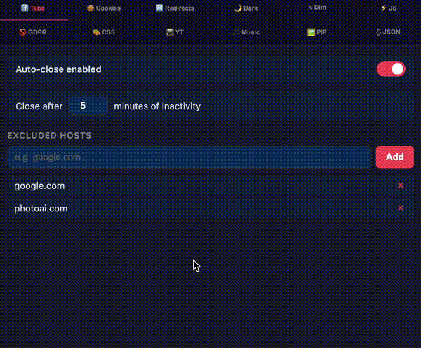

# 🚀 superlevels

by [@levelsio](https://x.com/levelsio)

[](https://github.com/levelsio/superlevels/stargazers)

Please star SuperLevels if you like it!

A super Chrome extension that replaces 12+ separate extensions with one open-source, privacy-respecting package.

Most Chrome extensions are closed-source malware/spyware-filled garbage that form a massive security risk. This one is open source and you can read and check the source code (with AI) before you install it, and customize it to your liking!

## Demo



## Security

Before installing any Chrome extension, you should verify it's safe. This extension is fully open source so you can audit every line of code yourself — or let AI do it for you:

1. Clone this repo or point your AI tool at the source code
2. Use [Cursor](https://cursor.sh), [Claude Code](https://claude.ai/claude-code), [Codex](https://openai.com/index/openai-codex/), or any AI coding tool
3. Ask it: *"Analyze this Chrome extension for security vulnerabilities, malware, spyware, data exfiltration, and any suspicious behavior"*
4. Read the report before you install

You should do this for **every** Chrome extension you use. Most extensions are closed-source and can't be audited — this one can.

## Features

### 🚮 Tab Cleaner
Automatically closes inactive tabs after a configurable timeout (default: 3 days; time away from the computer or with Chrome closed doesn't count). Set excluded hosts to keep important tabs alive. Closed tabs are saved to a OneTab-style list page (opened automatically in the background), grouped by day — click a tab to restore it, or restore/delete a whole day at once.

### 🍪 Cookie Editor
Full cookie manager for the current site. View, edit, add, and delete cookies. Export cookies as JSON. Expand any cookie to see and modify all fields including domain, path, SameSite, secure, and httpOnly flags.

### 🔀 Redirect Tracer
See every redirect hop your browser took to reach the current page. Shows status codes (301, 302, 307, etc.) with a visual chain. Copy the full redirect chain to clipboard.

### 🌙 Dark Mode
Instant dark mode for any website using CSS filter inversion. Adjustable brightness. Toggle per-site or globally. Images and videos are automatically re-inverted so they look normal.

### 𝕏 X Dim Mode
Custom dim theme for X/Twitter with 7 color palettes: Dim, Slate, Jade, Plum, Dusk, Ember, or a custom hue. Live preview in the popup.

### ⚡ JS Toggle
Disable JavaScript per-site with one click. Useful for debugging, reading articles without popups, or testing progressive enhancement. Page reloads automatically.

### 🚫 GDPR Cookie Consent Dismisser
Auto-hides and auto-clicks cookie consent banners. Supports OneTrust, CookieBot, Didomi, Quantcast, GDPR plugins, and dozens more frameworks. Toggle off if a site breaks.

### 🎨 Live CSS Editor
Write custom CSS for any website, applied in real-time as you type. Saved per-domain. Supports tab key for indentation.

### 📺 YouTube Unhook
Removes YouTube distractions: no homepage feed, no sidebar suggestions, no end screen overlays, no Shorts. Search still works — just no algorithmic recommendations.

### 🫛 Photopea No Ads
Hides the 320px ad column on [photopea.com](https://www.photopea.com) and expands the editor to the full window width (Photopea sizes the editor from `window.innerWidth - 320`, so a main-world script reports the window as 320px wider). Toggle in the popup.

### 🛡 Ad Block
Blocks ad and tracker requests and hides the empty ad slots they leave behind, like [uBlock Origin Lite](https://github.com/uBlockOrigin/uBOL-home). [EasyList](https://easylist.to) and EasyPrivacy are compiled into Chrome's built-in `declarativeNetRequest` rules (about 13,000 rules covering roughly 90,000 domains), so Chrome does the blocking itself and no page traffic passes through the extension. The icon badge shows how many requests were blocked on the current page. Pause it per site if something breaks. Not included: YouTube video ads, popup blocking, and scriptlet/procedural filters.

**Extra lists**, each off until you switch it on: cookie notices, social widgets (like/share buttons, embedded feeds), newsletter pop-ups, notification prompts, and other annoyances (chat widgets, "open in app" banners). These are [Fanboy's lists](https://easylist.to) from the EasyList authors. With every list on, it comes to about 17,000 rules, inside Chrome's 30,000-rule budget for dynamic rules.

**Optional, needs a one-time build.** The compiled lists aren't in the repo. Until you build them, Ad Block stays off and everything else works normally. See [Install](#install), step 7.

### 👁 Trackers
Shows which third parties the current page talks to: each tracker's name, company and category (advertising, analytics, social media…), how many requests it made, and whether they were blocked, like the old Ghostery. Block a single tracker, an unknown host, or a whole category (advertising, analytics, social, chat widgets…) everywhere with one switch. Categories that break sites when blocked (CDNs, video players, "essential") can only be blocked one tracker at a time. Requests are only observed, and the log stays in your browser.

Names and categories come from the [WhoTracks.Me](https://whotracks.me) database (via [AdGuard companiesdb](https://github.com/AdguardTeam/companiesdb)). It's optional too: without it, the panel lists bare hostnames. Build it with `node scripts/build-trackers.mjs` (see [Install](#install), step 7).

### 🗄 No Paywall
Opens paywalled news articles straight on [archive.is](https://archive.is) — e.g. an nytimes.com article goes to `archive.is/https://www.nytimes.com/...`. Only article URLs redirect (homepages and section fronts don't), tracking params are stripped so existing snapshots match, and links clicked from an archive page open the original. The site list (NYT, WSJ, FT, Bloomberg, Economist, plus Dutch, German, French, Italian, Spanish and Nordic papers like NRC, Volkskrant, Spiegel, Zeit, Le Monde, Corriere, El País) is editable in the popup.

### 🎵 Music Recognizer
Shazam-like music identification for any tab. Captures 10 seconds of audio and identifies the song via [ACRCloud](https://www.acrcloud.com/sign-up/) (free signup, bring your own API key). Results link to YouTube. History of recognized songs.

### 🖼 Picture-in-Picture
Pop the largest video on the current tab into a floating PiP window with one click.

### 🗺 Google Maps Links
Re-adds clickable Maps links and map preview cards to Google Search results.

### 🖼 View Image
Adds a "View Image" button back to Google Images, linking directly to the full-size original image.

### {} JSON Formatter
Auto-detects pure JSON response pages and formats them with syntax highlighting, collapsible sections, and a dark theme. Copy or view raw with one click. Never triggers on regular HTML pages.

### 📥 Bookmark Inbox
Files the bookmarks that pile up in one folder (Mobile bookmarks by default, so everything saved on your phone) into the folders where they belong. A bookmark gets a suggested folder only when the evidence is clear: it's already bookmarked there, or most of that site's bookmarks live there. Accept, pick another folder (typing a new path creates it), or delete. Decisions stay pending until you apply them as one batch, which you can undo from the popup.

### 🪦 Dead Links
Checks every bookmark while the tab is open and finds the ones that are really gone: a 404 or 410, or a site that can't be reached at all. A bookmark is only called dead after it fails on two scans at least 20 hours apart, so a brief outage never costs you a bookmark. Login walls, 403s, server errors and timeouts go under "Check yourself", and local-network addresses are skipped. "Remove selected" deletes the checked ones in one batch you can undo from the popup.

### 🧹 Tidy Bookmarks
Finds three kinds of clutter:
- the same page saved more than once (http/https, `www.`, trailing slashes and tracking parameters don't matter);
- URLs carrying tracking parameters such as `utm_*` or `fbclid`;
- folders with no bookmarks in them.

Every change is previewed before anything happens. For duplicates, the copy in the most specific folder is kept, and you can pick another. If the kept copy has no real title, it takes one from a removed copy. Each section is applied as one batch you can undo from the popup.

All three open from the popup's **🔖 Bookmarks** page.

### 🔖 Bookmark Bridge
Lets programs on your computer reorganize your bookmarks through Chrome's own bookmarks API while Chrome runs, so Chrome Sync uploads the changes the way it uploads edits you make by hand. (Editing Chrome's `Bookmarks` file instead doesn't sync reliably: Sync can undo the edits or bring deleted bookmarks back.) Every batch of changes is listed in the popup and can be undone from there. Off by default. While off, no program runs and nothing can change your bookmarks.

<details>
<summary>Protocol for writing a host</summary>

When the bridge is on, the extension connects to the [native messaging](https://developer.chrome.com/docs/extensions/develop/concepts/native-messaging) host `com.superlevels.bookmarks`. Register it by writing `~/Library/Application Support/Google/Chrome/NativeMessagingHosts/com.superlevels.bookmarks.json`, with `allowed_origins` set to this extension's id. The connection stays open, and the extension retries every minute if it drops.

The host sends requests `{id, method, params}`. The extension answers `{id, result}` or `{id, error}`.

| Method | Params | Result |
|---|---|---|
| `ping` | | `{version}` |
| `getTree` | | `chrome.bookmarks.getTree()` |
| `apply` | `{ops, batch?, label?}` | `{done, created, error?, failedOp?}` |

`ops` run in order and stop at the first failure:

- `{op: "create", ref, parentId, index?, title, url?}`
- `{op: "move", id, parentId, index?}`
- `{op: "update", id, title?, url?}`
- `{op: "remove", id}`

A `create`'s `ref` can be used as `id` or `parentId` by later ops in the same request. `created` maps each ref to its new id. `remove` refuses a folder that isn't empty, so remove its contents first. Requests that share a `batch` id appear as one entry in the popup and are undone together. `label` names that entry.

Messages to the extension are limited to 1 MB, so split large changes into several requests with the same `batch`. Code: `src/background/bookmarkbridge.js`.
</details>

## Install

1. Download or clone this repo
2. Open Chrome and go to `chrome://extensions/`
3. Click **Manage Extensions** if you're not already there
4. Enable **Developer mode** (toggle in the top right corner)
5. Click **Load unpacked**
6. Select the `superlevels` folder
7. *Optional, for Ad Block:* with [Node.js](https://nodejs.org) 18 or newer, run this in the `superlevels` folder, then click the reload icon on the extension in `chrome://extensions/`:
   ```sh
   node scripts/build-adblock.mjs
   ```
   This downloads EasyList, EasyPrivacy and the optional extra lists and compiles them into `data/adblock/`. It needs no `pnpm install`. Run it again whenever you want fresher lists. *For tracker names in the 👁 Trackers panel*, also run `node scripts/build-trackers.mjs`.
8. The 🚀 icon appears in your toolbar — you're done!

## Development

The only build steps are the optional Ad Block lists and tracker database. Their outputs (everything under `data/`) are gitignored.

**Build the ad block lists.** This writes `data/adblock/rules.json`, `data/adblock/generic.css`, `data/adblock/cosmetic.json`, the same three as `data/adblock/extra-<list>.*` for each extra list, and `data/adblock/meta.json`:

```sh
pnpm build:adblock                                            # download fresh lists, extras included
node scripts/build-adblock.mjs easylist.txt easyprivacy.txt   # or core lists only, from local copies
```

Every list can be on at once, so the build also fails if all of them together would exceed the 29,000-rule budget. The tracker panel's block rules use dynamic rule ids 100,000–109,999. Ad Block owns the ids below that.

**Build the tracker database.** This writes `data/trackers/db.json`:

```sh
pnpm build:trackers                                           # download from AdGuard companiesdb
node scripts/build-trackers.mjs trackers.json companies.json  # or use local copies
```

The build fails and writes nothing if a download fails, if any rule wouldn't be valid for Chrome, or if the lists look too small. It writes all files at once, so an interrupted build can't leave a mix of old and new. `meta.json` marks a finished build, and the extension turns Ad Block on only when that file exists. The rules are loaded as dynamic `declarativeNetRequest` rules, because a static ruleset in the manifest whose file is missing would stop the whole extension from loading. Then reload the extension in `chrome://extensions` and run the tests.

**Run the tests.** This is an end-to-end run in a real Chromium with the extension loaded. Requests are answered locally, so no network is needed. It takes about 4 seconds.

```sh
pnpm install
pnpm test:setup        # once: downloads Playwright's Chromium (~100 MB)
pnpm test              # Ad Block tests are skipped until the lists are built
HEADED=1 pnpm test     # watch it run in a visible window
```

The tests use Playwright's Chromium because branded Google Chrome ignores `--load-extension`. `tests/extension.mjs` has a small `launchExtension()` helper for writing tests for the other features too.

## Privacy

- **No data collection.** Everything stays local in `chrome.storage.local`.
- **No analytics, no tracking, no phone-home.**
- The Bookmark Bridge is off by default. When on, it talks only to a local program you installed (Chrome native messaging), never to the network.
- Ad Block's filter lists and the tracker database are downloaded only when you run the builds yourself, never by the extension at runtime.
- The 👁 Trackers panel logs which hosts each tab contacts, in memory and session storage only. The log is cleared when the tab closes.
- The only external network request is the Music Recognizer, which sends a short audio clip to ACRCloud — and only when you explicitly click "Listen" and provide your own API keys.
- All source code is right here. Read it, audit it, fork it.

## License

MIT, for the extension's code.

The optional data the builds download isn't in this repo and keeps its own licence:

| Data | Used for | Licence |
|---|---|---|
| [EasyList, EasyPrivacy](https://easylist.to) | Ad Block | GPL v3 or [CC BY-SA 3.0](https://creativecommons.org/licenses/by-sa/3.0/), by the EasyList authors |
| [Fanboy's lists](https://easylist.to) (cookie, social, newsletter, notifications, annoyances) | Ad Block extra lists | [CC BY 3.0](https://creativecommons.org/licenses/by/3.0/), by the EasyList authors |
| [AdGuard companiesdb](https://github.com/AdguardTeam/companiesdb), from [WhoTracks.Me](https://whotracks.me) | 👁 Trackers names and categories | [CC BY-SA 4.0](https://creativecommons.org/licenses/by-sa/4.0/) (WhoTracks.Me data: CC BY 4.0) |

All of these allow commercial use with attribution. Ghostery's TrackerDB, DuckDuckGo's Tracker Radar and Disconnect's list were left out on purpose: they're CC BY-NC-SA, which forbids commercial use.
